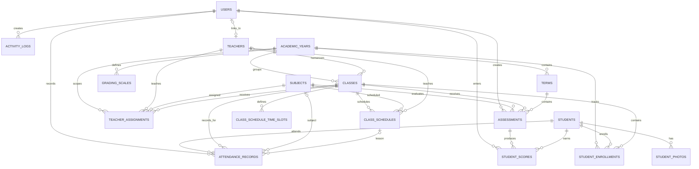
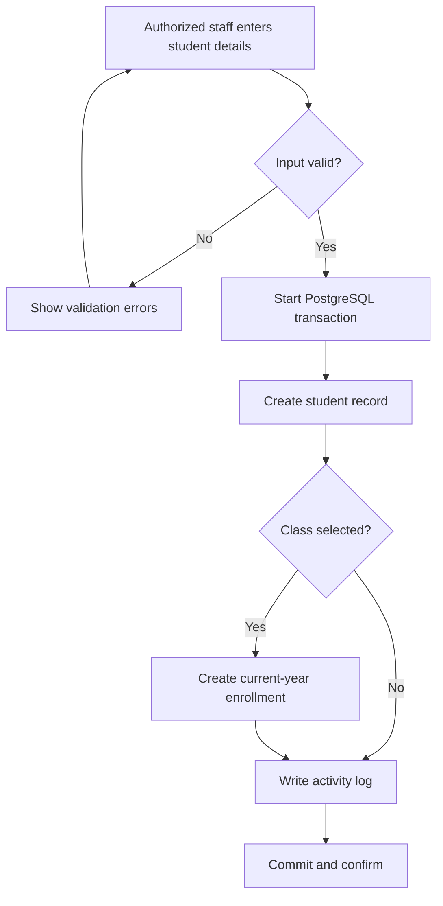
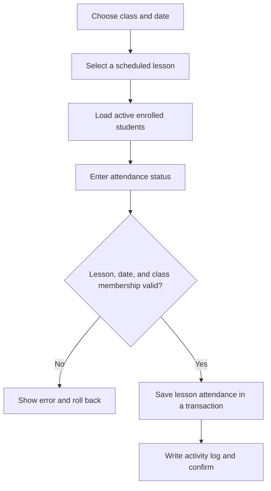

# Student Information Management System

A web-based school information system for managing student records, enrollment, attendance, assessments, reports, and staff workflows. The React interface uses an Express API, PostgreSQL for application data, and private Supabase Storage for student photos, with optional school-LAN photo storage and synchronization.

## What the system does

- **TPS — Transaction Processing System:** staff record student enrollment, scheduled-lesson attendance, assessments, and scores.
- **MIS — Management Information System:** live dashboards and reports summarize school records for operational monitoring.
- **DSS — Decision Support System:** configurable attendance and performance indicators explain which records may need staff review. They support human judgment and do not make decisions about students.

All dashboard and report figures come from PostgreSQL; the interface does not substitute demo statistics.

## Features

### School records and workflows

- Register, search, filter, edit, archive, and manage students and enrollment history.
- Manage teachers, classes, subjects, academic years, teacher assignments, and weekly class schedules.
- Record attendance for a scheduled lesson and date. The schedule supplies the assigned subject and teacher; submitting again updates that lesson's records.
- Create assessments, enter and validate scores, and review academic results.
- Scope teacher access to assigned classes and subjects across student, attendance, assessment, report, and timetable data.
- Search across students, teachers, classes, subjects, schedules, attendance, and academic results. Teacher search results respect their assigned scope.

### Dashboards, reports, and records

- View live enrollment, attendance, subject-average, and academic-performance summaries.
- Explore attendance and enrollment trends with date ranges and relevant class, grade, academic-year, term, and subject filters.
- Use attendance and performance flags with explanations, class comparisons, and enrollment trends to support staff review.
- Generate enrollment, roster, attendance, absence, academic-result, class-performance, and enrollment-trend reports; export CSV or print.
- Review activity history with actor identity, record snapshots, field-level changes, and request context. Sensitive values such as passwords and tokens are excluded.
- Move supported records to Trash and restore eligible records; trashed records are omitted from normal lists and reports.

### Accounts and student photos

- Sign in with role-based access for **SuperAdmin**, **Admin**, **Teacher**, and **School Manager**.
- Require a password change for newly generated or initialized credentials. SuperAdmins can manage accounts, roles, and teacher login credentials; Admins cannot manage user accounts or roles.
- Store student photos in a private Supabase Storage bucket, or use local filesystem storage on the school-LAN backend with queued uploads to Supabase. Photo retrieval goes through the authorized API.
- Use public UUIDs in API responses and URLs while database numeric IDs remain internal. New student, teacher, and subject codes follow formats such as `STU-000001`, `TCH-000001`, and `SUB-000001`.

## Technology

| Component | Technology |
| --- | --- |
| Web client | React 18, Vite, Tailwind CSS, Recharts, Lucide React |
| API | Node.js 20+, Express 5, Zod |
| Database | PostgreSQL, accessed through `pg` |
| Authentication | `express-session`, PostgreSQL session storage, bcrypt |
| Photo storage | Private Supabase Storage; optional school-LAN file queue |
| Tests | Node.js built-in test runner |

```text
Browser (React / Vite)
  └── credentialed API requests ──> Express
                                      ├── validation, role checks, and rate limits
                                      ├── PostgreSQL session store and application data
                                      └── private Supabase Storage or school-LAN photo storage
```

## Requirements

- Windows 10/11, Node.js 20 or newer, and npm.
- A Supabase project with PostgreSQL and a private Storage bucket.
- Access to the Supabase SQL Editor to initialize a new database.

## Local setup

### 1. Initialize PostgreSQL

For a new database, run [`database/schema.postgres.sql`](./database/schema.postgres.sql) in the Supabase SQL Editor. Optionally run [`database/seed.sql`](./database/seed.sql) afterward for fictional development records.

The database scripts without a `.postgres` suffix are legacy MySQL files. Do not run them against PostgreSQL. Schema upgrades are explicit operator actions; back up and review the target database before applying migrations.

### 2. Configure the backend

From the repository root, create the local environment files:

```powershell
Copy-Item .\server\.env.example .\server\.env
Copy-Item .\client\.env.example .\client\.env
```

Edit `server/.env` and set the PostgreSQL connection values (`DB_HOST`, `DB_PORT`, `DB_NAME`, `DB_USER`, and `DB_PASSWORD`), a random `SESSION_SECRET` of at least 32 characters, and the Supabase Storage settings (`SUPABASE_URL`, `SUPABASE_SECRET_KEY`, and `SUPABASE_STORAGE_BUCKET`). Keep `DB_SSL=true` for Supabase. Create the private bucket before uploading photos. For a school-LAN backend that must accept photos offline, set `STORAGE_DRIVER=local`; photos are stored in `server/storage/student-photos` and synchronized in both directions in Hybrid Mode.

In the administrator Settings panel, choose **Local to Cloud**, **Cloud to Local**, or **Both Ways** for a manual Hybrid Mode sync. This selection applies to database changes and queued student-photo uploads/downloads; automatic sync remains bidirectional.

The client uses `http://localhost:5000/api` by default. `VITE_API_URL` is public browser configuration; never put database, session, or Supabase secret values in client environment variables. Do not commit `.env` files.

### 3. Install, test, and create the first administrator

```powershell
Set-Location .\server
npm.cmd ci
npm.cmd test
npm.cmd run setup-admin
```

The setup utility creates an administrator only if one does not already exist. It is disabled in production and will not reset an existing account. Configure `ADMIN_USERNAME` and `ADMIN_PASSWORD` in `server/.env` if you want to choose the initial credentials.

### 4. Start the application

Start the API in one terminal:

```powershell
Set-Location .\server
npm.cmd run dev
```

Start the client in a second terminal:

```powershell
Set-Location .\client
npm.cmd ci
npm.cmd run dev
```

Open <http://localhost:5173>. The API listens on port 5000 by default; check <http://localhost:5000/api/health>.

## Database schema

The backend's PostgreSQL schema is [`server/database/schema.postgres.sql`](./server/database/schema.postgres.sql). The project also includes setup and migration SQL under [`database/`](./database) and a detailed operations guide in [`DATABASE.md`](./DATABASE.md). Apply the schema and migrations intended for the specific deployment; back up existing databases before making schema changes.

| Area | Tables | Purpose |
| --- | --- | --- |
| Accounts and audit | `users`, `user_sessions`, `activity_logs` | Staff accounts, PostgreSQL-backed login sessions, and audit history |
| School organization | `academic_years`, `terms`, `classes`, `teachers`, `subjects` | School years, terms, classes, staff, and subjects |
| Teaching structure | `teacher_assignments`, `class_schedules`, `class_schedule_time_slots` | Class/subject assignments and weekly lesson schedules |
| Student lifecycle | `students`, `student_enrollments`, `student_photos` | Student profiles, class/year enrollment history, and photo metadata |
| Attendance and results | `attendance_records`, `assessments`, `student_scores`, `grading_scales` | Scheduled-lesson attendance, assessments, marks, and grade bands |
| Recycle bin | `trash_records` | Deletion metadata for supported records |

### Entity relationships



Application records use internal numeric keys for database relationships and public UUIDs for API-facing identifiers. Photo objects live in private Supabase Storage; `student_photos` stores their metadata. `user_sessions` is managed by the session store, and Trash records identify supported records by entity type and public UUID rather than ordinary foreign keys.

## Database synchronization

The existing cloud deployment does not run database synchronization. A separately operated school-LAN backend can use these database modes:

| Mode | Active database | Synchronization |
| --- | --- | --- |
| `LOCAL` | Local PostgreSQL | Paused; the application can operate without the cloud database |
| `CLOUD` | Cloud PostgreSQL | Paused; supports the existing `DB_*` configuration |
| `HYBRID` | Local PostgreSQL | Bidirectional synchronization with cloud PostgreSQL |

Only the school-LAN backend runs the synchronization worker. Before enabling Hybrid Mode, back up both databases, confirm their schemas and migrations are compatible, and apply the sync migration to both. Mode changes do not copy or delete application records; conflicting edits require administrator resolution. See [`DEPLOYMENT.md`](./DEPLOYMENT.md) for configuration and migration steps.

## Processes

### Student registration



### Lesson attendance



## Validation

Run the backend tests:

```powershell
Set-Location .\server
npm.cmd ci
npm.cmd test
```

Build the frontend:

```powershell
Set-Location .\client
npm.cmd ci
$env:VITE_API_URL = "http://localhost:5000/api"
npm.cmd run build
```

The backend tests do not require production credentials or a live database. GitHub Actions runs backend tests and the frontend production build on Node.js 20 and 22.

## Deployment and project guides

The production deployment uses a Netlify-hosted frontend, a Render-hosted Express API, and Supabase PostgreSQL and Storage. Configure `VITE_API_URL=/api` for the frontend proxy and set the exact deployed frontend origin in the backend's `CLIENT_URLS`. See [`DEPLOYMENT.md`](./DEPLOYMENT.md) for provider configuration and release checks.

- [`DEPLOYMENT.md`](./DEPLOYMENT.md) — local, school-LAN, and production deployment.
- [`DATABASE.md`](./DATABASE.md) — PostgreSQL schema, migrations, indexes, and backups.
- [`SECURITY.md`](./SECURITY.md) — security controls and operational considerations.
- [`RATE_LIMITING.md`](./RATE_LIMITING.md) — rate-limit policy and configuration.
- [`PROJECT_AUDIT.md`](./PROJECT_AUDIT.md) — project audit, implemented changes, and limitations.

Keep database, session, and Supabase secret values on the backend. Restrict access to activity logs, which may contain personal and device metadata, and follow the school's data-retention policy.
